<div align="center" style="display: flex; align-items: center; flex-wrap: wrap; justify-content: center;">
  <picture style="width: 80%;">
    <source srcset="logo_text_dark2.png" media="(prefers-color-scheme: dark)">
    
  </picture>
</div>


<p align="center">

</p>

<hr style="background: #b4c5fb !important;">

<p align="center">
<a href="https://github.com/jellyfin/jellyfin/releases/latest"></a>
<a href="https://github.com/jellyfin/jellyfin/releases/tags/v10.11.11"></a>
<a href="https://github.com/jellyfin/jellyfin/releases/tag/v10.10.7"></a>
</p>
<p align="center">

<a href="https://discord.gg/ussYu37xKG"></a>
</p>

**KefinTweaks is a comprehensive collection of enhancements and customizations for Jellyfin, focused on, but not limited to, filling gaps in functionality based on the community's most desired [Feature Requests](https://features.jellyfin.org/?view=most-wanted). This includes things like a [Watchlist](#watchlist), a [customizable Home Screen](#enhanced-home-screen), an [improved search experience](#enhanced-search), and an [Appearance Manager](#skin-manager)**.

While working on these scripts to meet my personal needs, I noticed that there was a lot of overlap between the functionality I desire and many of the requested features by the community so I thought it would be a good idea to share this for anyone who may be interested.

Since I began working on this in August 2025, the scope of the project has grown and changed drastically. This began as a small set of tweaks to enhance my own personal server, but has evolved into a robust set of features that aim to compliment and enhance the native Jellyfin experience in a way that feels like it _is_ native functionality.

In the future, we can hope that the majority of this plugin will become obsolete as we will see many of these changes implemented and included in the native Jellyfin experience, as the community has so long desired!

I think it's also worth mentioning that before the 1.0 release, you can expect to potentially encounter some issues or bugs. I try to address these as quickly as I can, and I appreciate your time for raising the issues in the first place!

Note: The Slideshow at the top of the Home Screen in the video below is from the [MediaBar](https://github.com/IAmParadox27/jellyfin-plugin-media-bar) plugin by [IAmParadox27](https://github.com/IAmParadox27) and [MakD](https://github.com/MakD).

[](https://youtu.be/4ikW4CFSn3I)

## Table of Contents

- [Installation](#installation)
    - [Prerequisites](#prerequisites)
    - [Setup Instructions](#setup-instructions)
- [Configuration](#configuration)
- [Features Overview](#features-overview)
    - [Data Caching](#data-caching)
    - [Community Requests Progress](#community-request-progress)
        - [Feature Requests Completed](#-feature-requests-completed)
        - [Feature Requests Planned](#-feature-requests-planned)
    - [Core Features](#core-features)
        - [Watchlist](#watchlist)
            - [Watchlist Page](#watchlist-page)
            - [Series Progress Page](#series-progress)
            - [Movie History Page](#movie-history)
            - [User Statistics Page](#statistics)
            - [Export/Import](#exportimport)
        - [Enhanced Home Screen](#enhanced-home-screen)
        - [Enhanced Search](#enhanced-search)
        - [Thumbnail Scrubber](#thumbnail-scrubber)
        - [Watch Together](#watch-together)
        - [Version Preferences](#version-preferences)
        - [User Manager](#user-manager)
        - [Library Mini-Games](#games)
    - [UI Enhancements](#ui-enhancements)
        - [Watchlist Support](#watchlist-support)
        - [Skin Manager](#skin-manager)
    - [UX Improvements](#ux-improvements)
        - [Subtitle Search](#subtitle-search)
        - [Remove from Continue Watching](#remove-from-continue-watching)
        - [Collection Sorting](#collection-sorting)
    - [Navigation Improvements](#navigation-improvements)
        - [Header Tab Enhancements](#header-tab-enhancements)
        - [Breadcrumb Navigation](#breadcrumb-navigation)
        - [Custom Menu Integration](#custom-menu-integration)
        - [Playlist Screen Improvement](#playlist-screen-improvement)
        - [Flatten Single Season Shows](#flatten-single-season-shows)
        - [Collections on Movie/Series Details page](#collections-on-movieseries-details-page)
        - [Desktop Hamburger Menu](#desktop-hamburger-menu)
        - [Custom Pages](#custom-pages)
    - [System Improvements](#system-improvements)
        - [Performance & Stability](#performance--stability)
        - [Branding & Customization](#branding--customization)
- [Info For Developers](#info-for-developers)
- [Client Support](#client-support)
- [Changes to default Jellyfin functionality](#changes-to-default-jellyfin-functionality)
- [Design Philosophy](#design-philosophy)
- [AI Disclaimer](#ai-disclaimer)
- [License](#license)
- [Acknowledgments](#acknowledgments)
- [Support](#support)
- [FAQ](#faq)
- [Version History](#version-history)

## Installation

### Prerequisites

- Jellyfin 12, 11 or 10
- [JS Injector](https://github.com/n00bcodr/Jellyfin-JavaScript-Injector) plugin installed and configured
- [File Transformation Plugin](https://github.com/IAmParadox27/jellyfin-plugin-file-transformation) plugin is recommended to avoid file permission issues when injecting scripts with JS Injector

### Setup Instructions

0. **Install the Prerequisites listed above**
1. **Add a new script to your JS Injector Plugin**
2. **Copy the code below, paste it into the new script, save your changes and refresh the page**

```javascript
const script = document.createElement("script");
script.src = `https://cdn.jsdelivr.net/gh/ranaldsgift/KefinTweaks@latest/kefinTweaks-plugin.js`;
script.async = true;
document.head.appendChild(script);
```

If you are hosting the script yourself, replace the `https://cdn.jsdelivr.net/gh/ranaldsgift/KefinTweaks@latest/` with your hosted location + `/KefinTweaks/`. You should be able to include the scripts in your jellyfin-web folder and access it from `/web/KefinTweaks` if you like.

3. **Navigate to the Plugins page and click on KefinTweaks**
4. **Choose your preferred plugin version, or specify a custom source if you are self hosting the scripts**
5. **Press Install! KefinTweaks will automatically load without refreshing the page**

| KefinTweaks in 60 seconds |
| :---: |
| 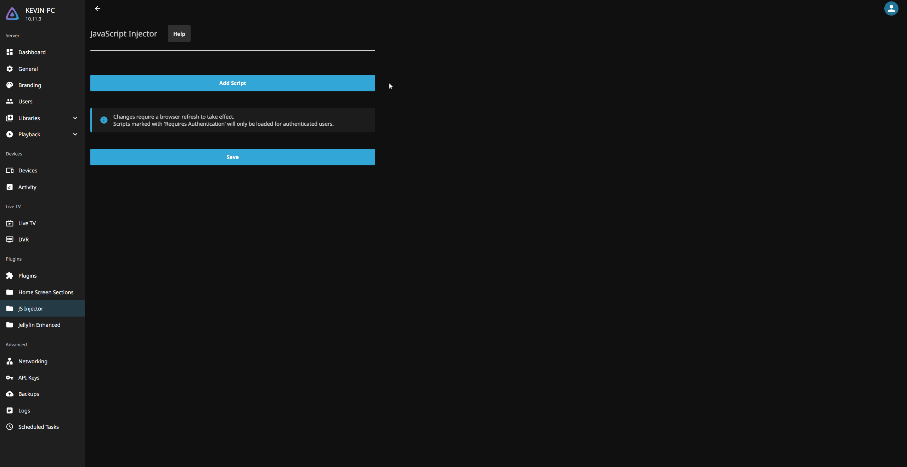 |

&nbsp;

## Configuration

KefinTweaks includes a comprehensive configuration interface accessible to administrators. The configuration UI allows you to customize all aspects of KefinTweaks without editing code files.

### Accessing Configuration

The configuration interface can be accessed in multiple ways:

1. **From Dashboard**: In the Dashboard side menu, find the "KefinTweaks" button under the Plugins section.
2. **From Left Navigation Menu**: A "Configure" link will appear in the left navigation menu beneath a KefinTweaks heading.
3. **From User Preferences**: Navigate to your User Preferences page and find the "Administration" section. Click the "Configure KefinTweaks" button.

### Configuration Features

All configuration options for KefinTweaks can be managed directly from the UI.

- **Feature Toggle**: Toggle individual KefinTweaks features on or off
- **Home Screen Configuration**: Configure custom sections, discovery features, and seasonal content
- **Search Configuration**: Enable/disable Seerr integration (requires JellyfinEnhanced plugin)
- **Skin Configuration**: Manage available skins, set default skins, and enable/disable specific skins
- **Theme Configuration**: Add custom themes available to all users
- **Exclusive Elsewhere Configuration**: Configure branding behavior
- **Custom Menu Links**: Add custom links to the navigation menu
- **Script Root URLs**: Configure custom script hosting locations (advanced)

### Export and Import

- **Export**: Export your entire configuration to clipboard as JSON for backup or sharing
- **Import**: Import a previously exported configuration to restore settings or apply configurations from other servers

| Configuration Interface |
| :---: |
| 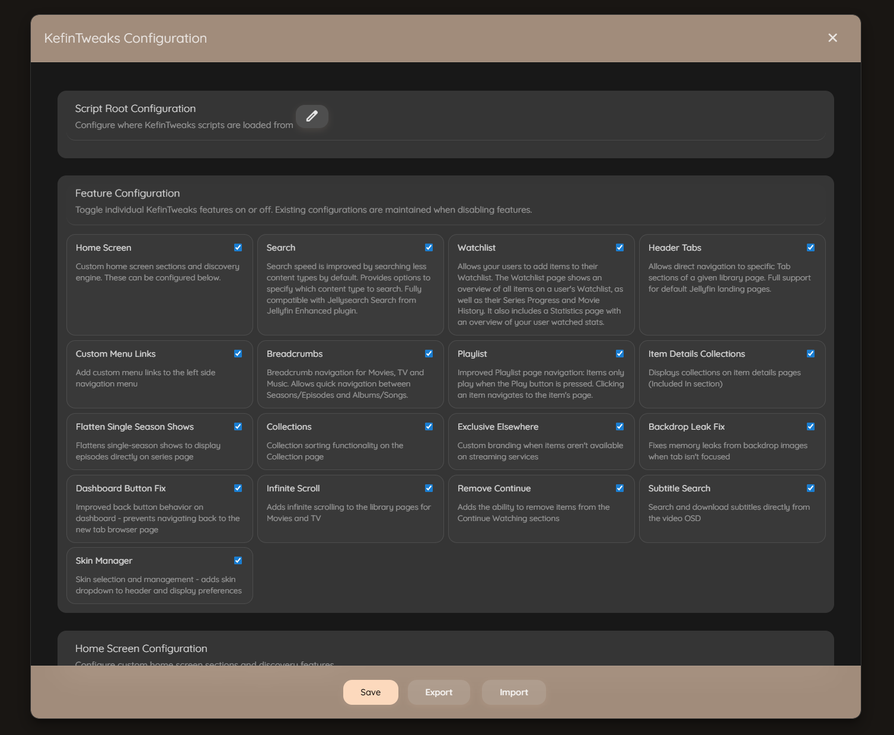 |
&nbsp;

### Automatic Setup

On first load, KefinTweaks automatically:

- Creates the `KefinTweaks-Config` script in the JavaScript Injector plugin with default settings
- Creates the `KefinTweaks-Injector` script in the JavaScript Injector plugin with default settings

These tasks only run for administrator users and happen automatically in the background.  
&nbsp;

## Uninstallation

1. **Navigate to the Plugins page and click on KefinTweaks**
2. **Press Uninstall and click to confirm**  
You can also choose to disable to plugin temporarily and re-enable it with a single click at any time from the Plugin Settings.

| Uninstall KefinTweaks |
| :---: |
| 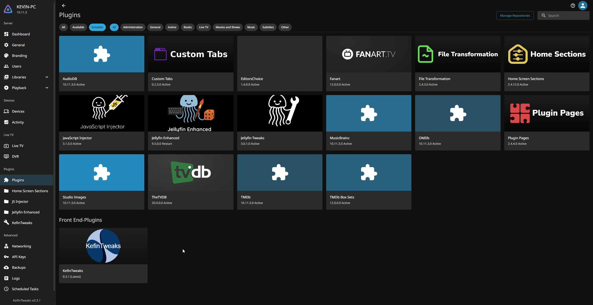 |

&nbsp;

## Features Overview

KefinTweaks provides a modular system of enhancements that can be individually enabled or disabled based on your needs. Each script is designed to work independently while sharing common utilities and dependencies.

As mentioned above, most of the functionality included in KefinTweaks are features that have been requested by the community. Some of these requests have been pending for 5 years or more. I feel that a lot of the top requests have functionality that is essential to the Jellyfin experience but I have also included less requested features, as well as some things that I just personally needed or wanted.  
&nbsp;

## Data Caching

One thing that I feel is worth pointing out is the way in which some of the data needed by KefinTweaks is handled. For most of the features, data is grabbed on demand as normal, same as any existing Jellyfin functionality. However there are specific features, or subsets of features which do use local device caching in order to either improve performance, or simply because it is not feasible to fetch the data each time. In the future if this ever becomes a plugin, the caching can be more intelligent and done on the server.

The features in KefinTweaks which use local data caching are listed below, along with accompanying explanations for why they are being cached. Everything is cached by default for 24h unless it is specified otherwise.

- Home Screen
    - **Genres** [24h]:  
      Genres are cached simply to reduce API calls to the server. This is not an expensive API call, but under most circumstances the results will be the same even across longer periods of time.
    - **Top People** [7d]:  
      In order to populate the "Top People" in your movie library, we fetch the Person data for every movie in your library. We build a list of all the People who appear in at least X number of items based on their type (Actor/Director/Writer). This is an expensive operation, and is longer as the size of your library grows.
- Watchlist
    - **Watchlist Items** [5m]:  
      These items are only cached after they are fetched on first page load. This means every time you refresh the page we fetch this data from the server and then in most situations will simply re-use that data until it expires 5 minutes later, or when the user manually refreshes the page.
    - **Series Progress and Movie History** [24h]:  
      These are both more expensive operations, especially if you have watched a very high number of Movies or Shows. It's not practical to fetch this data on demand so we cache it to improve UX.
- Collections on Details Page
    - **Collections** [1h]:  
    These items are only cached after they are fetched on first page load. Sadly I know no way to retreive a list of Collections that an Item is a child of from the API directly. The Ancestors endpoint only returns the physical ancestors of an item. In order to be able to populate the "Included In" section, we fetch the children from every Collection in your library and add the Item ID of each child to the cache.  
&nbsp;

## Community Request Progress

### ✅ **Feature Requests Completed**

- ✅ [Remove items from Continue Watching](https://features.jellyfin.org/posts/517/add-an-option-to-remove-an-item-from-continue-watching)
- ✅ [Watchlist like Netflix](https://features.jellyfin.org/posts/576/watchlist-like-netflix)
- ✅ [Remove pagination in favor of infinite scroll for library pages](https://features.jellyfin.org/posts/216/remove-pagination-use-lazy-loading-for-library-view)
- ✅ [Watched History](https://features.jellyfin.org/posts/633/watched-history)
- ✅ [On-Demand Subtitle Search in Video OSD](https://features.jellyfin.org/posts/3385/on-demand-subtitle-search)
- ✅ [Add genres and recommendations to home screen](https://features.jellyfin.org/posts/3501/add-genres-and-recommendations-to-home-screen)
- ✅ [New or Improved Home Screen Sections](https://features.jellyfin.org/posts/1986/new-or-improved-home-secreen-sections)
- ✅ [Custom Carousel Options on Home Screen](https://features.jellyfin.org/posts/1439/custom-carousel-options-on-home-screen)
- ✅ [Improved Playlist UX](https://features.jellyfin.org/posts/2823/playlist-moviesummary)
- ✅ [Flattening TV Shows with 1 season](https://features.jellyfin.org/posts/8/flattening-tv-shows) [[2]](https://features.jellyfin.org/posts/3352/add-option-to-flatten-single-season-tv-shows-skip-season-level)
- ✅ [List all collections that an item belongs to on the details page](https://features.jellyfin.org/posts/540/list-all-collections-that-a-movie-belong-to-in-movie-details) [[2]](https://features.jellyfin.org/posts/3540/collection-data-present-on-content-within-the-collection) [[3]](https://features.jellyfin.org/posts/3549/show-collections-on-movie-page)
- ✅ [Custom Skins/Themes](https://features.jellyfin.org/posts/2509/themes-skins-or-clone-plex-layout-to-convert-the-rest-of-the-plex-and-emby-user-base-to-jellyfin) [[2]](https://features.jellyfin.org/posts/2616/theme-skins)
- ✅ [TV Season Selection at the Series level](https://forum.jellyfin.org/t-tv-season-selection-when-browsing-seasons)
- ✅ [Add end time to detail page for entire shows and seasons](https://features.jellyfin.org/posts/3470/add-info-ends-at-hh-mm-for-each-season-and-whole-show)

### 🚧 **Feature Requests Planned**

- 🚧 [Keep original title option](https://features.jellyfin.org/posts/32/keep-original-title-option)
- 🚧 [Search by tag/genre](https://features.jellyfin.org/posts/276/search-by-tag-genre)
- 🚧 [Add drag and drop to library order](https://features.jellyfin.org/posts/3509/add-drag-and-drop-to-libray-order)  
&nbsp;

# Core Features

## **Watchlist**

### **Watchlist Page**

Tired of forgetting everything you wanted to watch? Add movies, series, seasons, and episodes to your Watchlist!
- **Auto-Remove**:  
  Automatically removes watched items from your watchlist when playback completes.

- **Real-time Updates**:  
Cached watchlist updates when toggling watchlist status from card overlays  

| Your Watchlist Page |
| :---: |
| 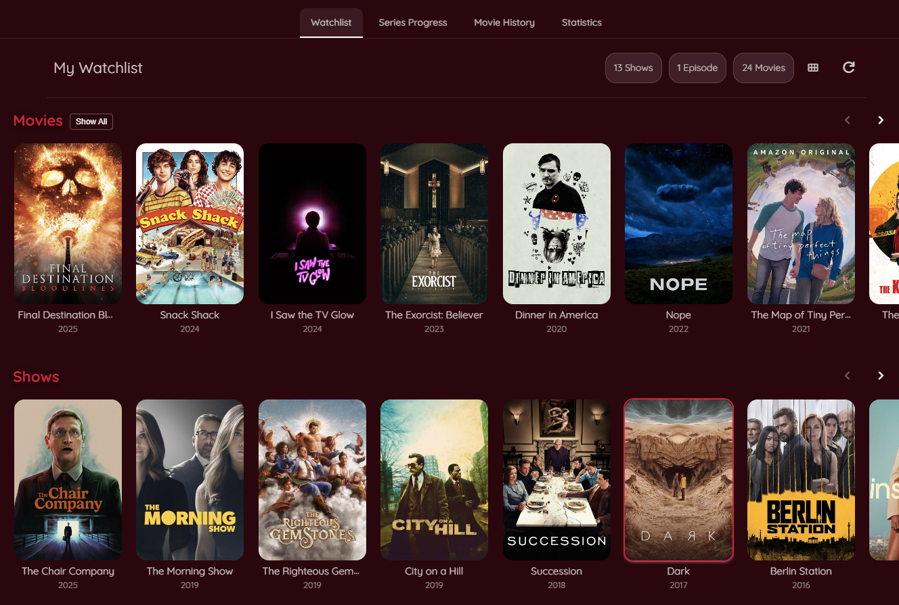 |  

### **Series Progress**

An overview of every series you've ever started watching with functionality to filter, sort and mark items as watched.

| Review your all your in-progress and completely watched Series |
| :---: |
| 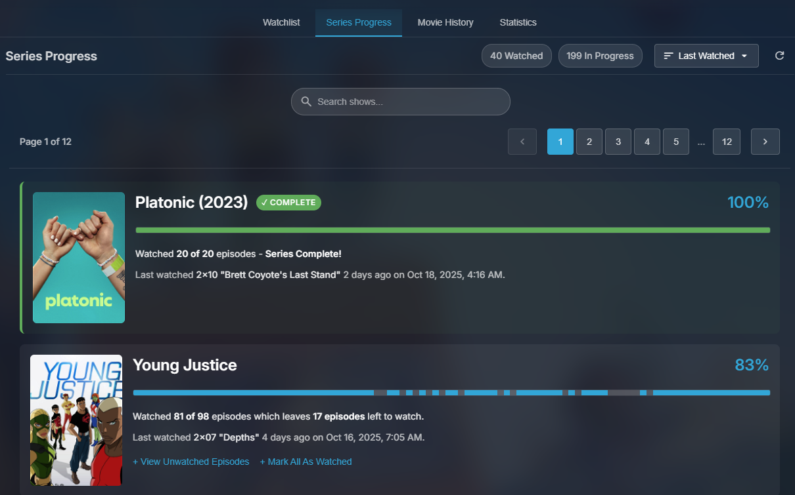 |

### **Movie History**

An overview of every movie you've ever watched with functionality to filter, sort and mark items as favorites.

| Check your full history of Watched Movies |
| :---: |
| 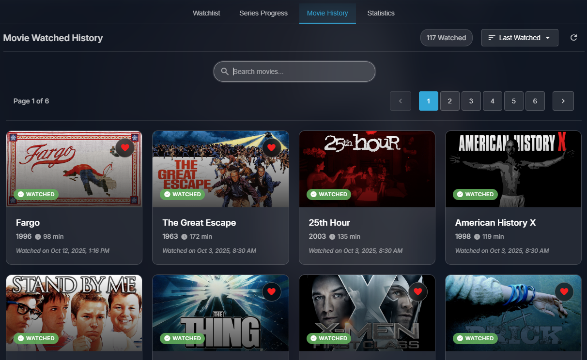 |

### **Statistics**

A summary of your watched items by the numbers. See how many movies, shows or episodes you have watched. Check our your Top Shows, Playback History, Watch Streaks and Binge Sessions.
  
| Playback History, Watch Streaks, Binge Sessions |
| :---: |
| 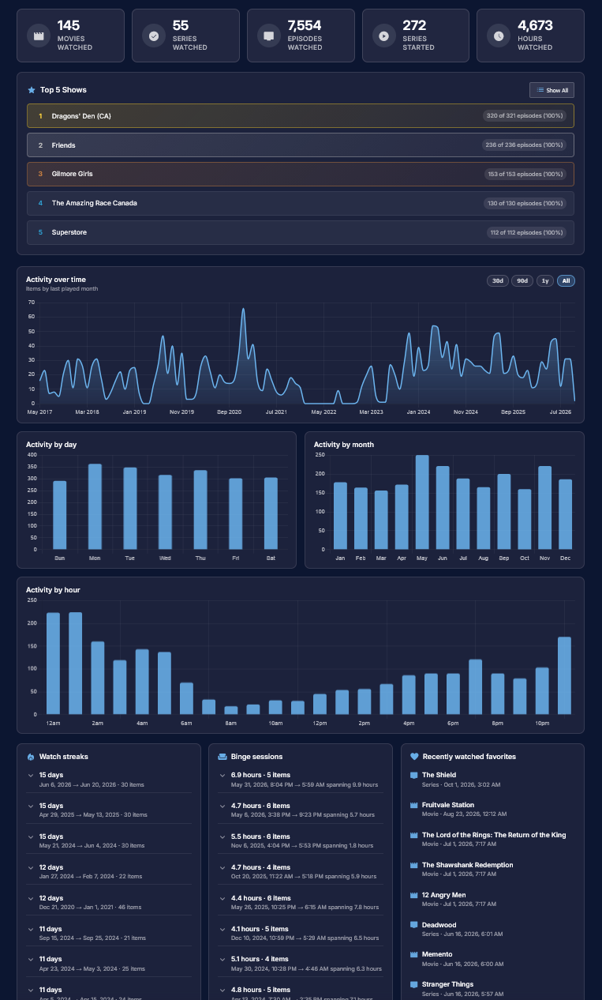 |

### **Export/Import/Sync**

Export your Watchlist to JSON which can later be imported using the Watchlist Import feature. You can use this feature to make bulk changes to your Watchlist if you need to. Additionally, you can Sync your Watchlist to any Playlist of your choice.

<table align="center" style="width: 100%;">
  <tr>
    <th style="text-align:center;">Watchlist Export</th>
    <th style="text-align:center;">Watchlist Import</th>
  </tr>
  <tr>
    <td style="width: 50%;">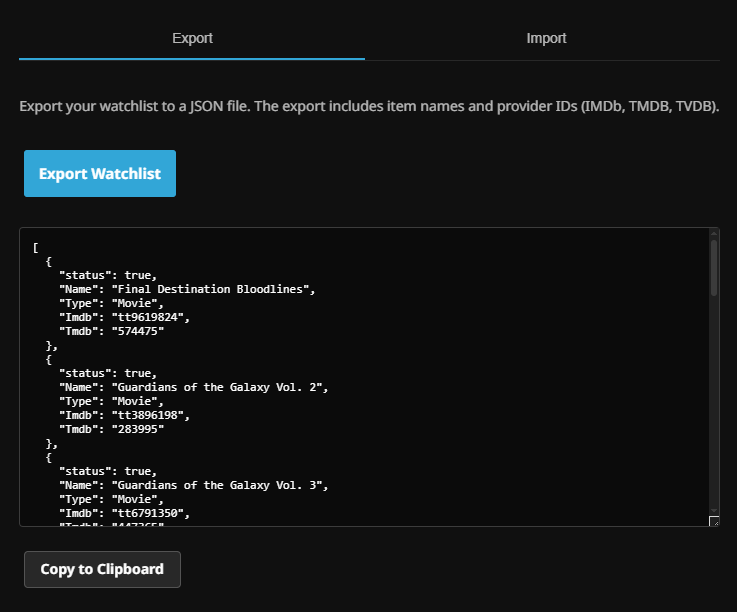</td>
    <td style="width: 50%;">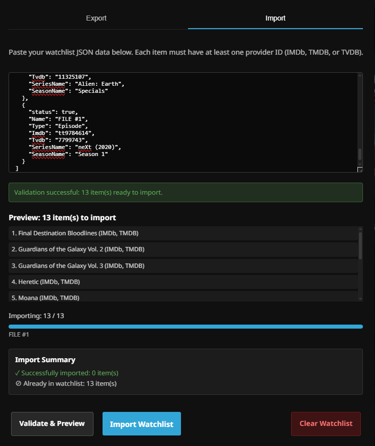</td>
  </tr>
</table>
&nbsp;

## **Enhanced Home Screen**

Have you ever wanted to be able to fully customize nearly every aspect of your Home Screen? Be able to set it up for all users in a particular way, with the ability for them to make changes to their liking? That's what the Enhanced Home Screen does. So much has been added here that it won't even be possible to give a clear overview of everything that is possible with the new features. I'll do my best to list out everything, but you can always ask me on Discord if you want to know how to create something specific that you can't quite figure out. It's probably achievable.

| Home Sections Available in KefinTweaks |
| :---: |
|  |

&nbsp;

- **Every native Jellyfin section**  
  KefinTweaks supports all of the native sections included in Jellyfin by default. The section status (enabled/disabled) in KefinTweaks will sync to your Jellyfin user preferences so these sections remain available when using a client that doesn't support KefinTweaks.

- **Custom Sections**:  
  Limited only by your creativity, you can create almost any section you like

- **New Releases**:  
  Creates sections for movies and episodes released in the last X days

- **Infinite Discovery Sections**:  
  Load discovery sections based on items you've watched, favorited and watchlisted, as well as from genres or top people in your library

- **HSS Support**:  
  Full compatibility with [Home Screen Sections](https://github.com/IAmParadox27/jellyfin-plugin-home-sections) plugin by [IAmParadox27](https://github.com/IAmParadox27/)

- **Thematic Picks**:  
  Thematic sections based around similar themes built from your library tags

- **Browse and Resume Playlists and Collections**:  
  Use these sections to browse your Playlists and Collection, and pick up where you left off in any currently in-progress playlists or collections

- **Browse By Studio**:  
  Adds a beautiful home screen row for popular Movie, TV and Streaming studios

- **More Live TV sections**  
  Show your TV Channels, or Programs by Category directly on your home screen

- **Seasonal Content**:  
  Create your own Seasonal sections or enable them from the ones already provided in KefinTweaks  

| Seasonally-themed sections with companion Seasonal Backgrounds and Animations |
| :---: |
| 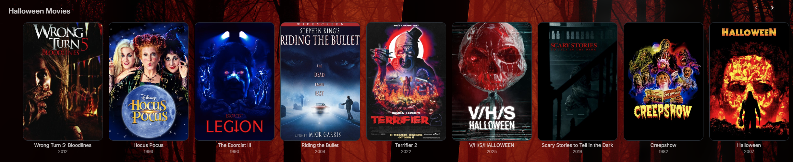 |  

&nbsp;

- **Watchlist Integration**:  
  Add a section for your Watchlist directly on your home screen

| Watchlist Section on Home Screen |
| :---: |
| 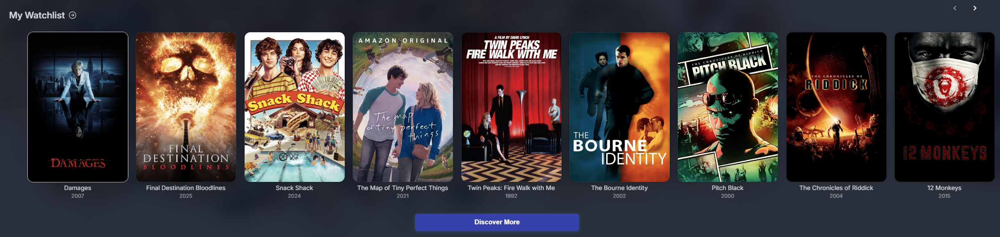 |  

&nbsp;

- **Home Category Navigation**:  
    - Adds navigation controls to navigate between Home / Discovery / Pinned or any custom Category
    - Start discovering content without scrolling through the entire home screen  

| Home Category Navigation |
| :---: |
|  |  

&nbsp;

- **Pinned Content**  
    - Pin specific items to your home screen
        - Choose a name for the section you want to pin the item to
    - Pin Children items to your home screen
        - Pick a Parent item: Studio, Genre, Series, Person, etc  

| Pinned Content |
| :---: |
|  |  

&nbsp;

- **Personalized Discovery Sections**  
    - Personalized dynamic recommendations based on your watch history, favorites, watchlist, etc
    - Suggested content from popular Genres, Studios, People
    - Custom user created static discovery sections (dynamic user created sections coming soon!  

| Personalized Discovery Sections |
| :---: |
|  |  

&nbsp;

- **Section Layout: Normal**
    - Pick the Artwork
        - Support for every Jellyfin artwork type
    - Pick a Border
        - 14 different border styles
        - Custom border color
    - Customize the footer text
        - 12 different fonts
        - Font size
        - Font color
        - Text capitalization options
        - Horizontal and vertical positioning (text overlay) 
    - Switch between Row and Grid view

| All existing Jellyfin artwork types supported |
| :---: |
|  |
| 14 Different Border Styles |
|  |  

&nbsp;

- **Section Layout: Spotlight**
    - Pick the Layout
        - Borderless
        - Border
    - Pick the size
        - Normal
        - Large
        - Full
    - Cycle your backdrops
        - Decide how many backdrops appear for an item before advancing slides
    - Tile your backdrops
        - Up to 3 backdrops side by side
    - Slide animations
        - Enable or disable animations
        - Pick your preferred animation for each backdrop tile  

| Spotlight Section Variations |
| :---: |
|  |  

&nbsp;

- **Section Editor: Wizard**
    - Use pre-defined templates to easily create new sections
    - Sections created by the Wizard can still be fully edited in the Advanced Editor later

| Section Creation Wizard |
| :---: |
|  |  

&nbsp;

- Section Editor: Advanced
    - Create any custom section where the limits are only what Jellyfin can handle
    - Define multiple queries for a section
        - Sort each query individually
        - Choose a post-process items strategy: Merge / Separate / Random
        - Choose a post-process sorting strategy
    - Merged mode results are merged before post processing
    - Separate mode adds a "Query Picker" to the section to switch between the defined queries
    - Random mode chooses one query from the list at random every time the section loads
    - Limited only by your creativity, you can create almost any section you like:
        - Top rated Series Premiere episodes from the last 365 days
        - Lowest rated Series that aired for more than a decade
        - Movies that start with the letter B and have a rating above 7
        - Movies released by Universal Pictures before 1995 starring Keith David

Just watch the [teaser trailer](https://www.youtube.com/watch?v=URw8q6acdmo) if you want an idea of the level of customization.  
&nbsp;

## **Enhanced Search**

- **Performance Improvements**:  
  Defaults to searching in Movies/TV/People as most searches are for these items. Options to search specific categories or all categories like the default Jellyfin search functionality.

- **Jellyseerr Support**:  
  If you have [JellyfinEnhanced](https://github.com/n00bcodr/Jellyfin-Enhanced) installed, the Jellyseerr search results will appear in the KefinTweaks enhanced search. There is also a button that lets users search specifically for Requests.

- **Meilisearch Support**:  
  Zero-config support for searching with the [Meilisearch](https://github.com/arnesacnussem/jellyfin-plugin-meilisearch) plugin

| Search by Content Type |
| :-: |
| 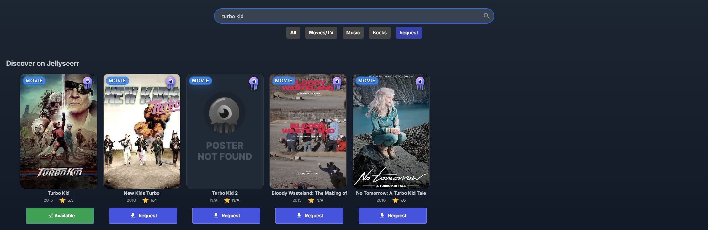 |

&nbsp;

## **Thumbnail Scrubber**
Tired of Youtube hover previews and the seekbar functionality to quickly seek through a video? Well, wake up! We brought it to Jellyfin.

- Adds a seekbar and "scrubbing" functionality when hovering a card similar to Youtube
- Optionally enable Video Previews on Hover
- Video Previews fallback to Trickplay when a static stream can't be completed

FR: [1](https://features.jellyfin.org/posts/139/show-video-preview-on-thumbnail-hover)

| Thumbnail Scrubber | Video Preview on Hover |
| :-: | :-: |
|  |  |

&nbsp;

## **Watch Together**
This feature is designed to be used by people who are watching something together on the same device and want the Watched status and progress to be synced to each of their individual accounts. This could be watching together in your living room, in the sauna, or even while you travel to the moon in your preferred spacecraft.

Authenticate the user accounts you want to sync progress with. If you have active users in your Watch Together group, you will be reminded at the beginning of playback if you'd like to continue syncing with any of them.

[Checkout how it works!](https://streamable.com/yfj8xk) The UI has been improved since this video, but the functionality remains.

FR: [1](https://features.jellyfin.org/posts/389/watch-together-watch-with-multiples-accounts), [2](https://features.jellyfin.org/posts/3950/would-love-to-see-a-watch-together-or-a-syncplay-feature-for-the-jellyfin-tv)  

| Video OSD Access and Reminder |
| :---: |
|  |

&nbsp;

## **Version Preferences**
Have you ever wanted Jellyfin to respect its own naming schemes? Why is that pesky 1080p version listed before the 4k version? Forget about it!

- Specify priorities across both Versions and Editions
- Add custom Version qualities and custom Edition names
- Multiple Versions from the same Edition are grouped together
- Your choice of format: "Edition - Version" or "Version - Edition"

FR: [1](https://features.jellyfin.org/posts/3816/smart-default-version-selection-for-grouped-media-by-bitrate-audio-tracks-codec-resolution), [2](https://features.jellyfin.org/posts/1465/multiple-editions-of-a-movie-with-multiple-resolutions), [3](https://features.jellyfin.org/posts/3758/option-to-manually-change-the-order-of-movie-versions-in-group-versions)  

| Prioritize your item Versions and Editions |
| :---: |
|  |

&nbsp;

## **User Manager**
Every Jellyfin admin cuts their teeth by manually configuring each of their freshly created user accounts with their preferred defaults. It's a time-honored tradition, but what do I know about tradition?

- Create User Templates
- Pick a default User Template
- New Users default to the chosen Template with the ability to select a different one instead
- Bulk Update existing users with the settings from any of your User Templates  

FR: [1](https://features.jellyfin.org/posts/3798/user-template), [2](https://features.jellyfin.org/posts/363/default-user-settings-on-user-creation), [3](https://features.jellyfin.org/posts/4006/a-feature-to-create-a-moderator-user)  

| User Profile Templates and Bulk User Editing |
| :---: |
|  |

&nbsp;

## **Games**
Frivolous games where the points don't matter? Test your knowledge of your library with some random mini-games!

- [Movie LUTs Game](https://game.movieluts.com/)
- 3x3 Game - Guess the movies from the backdrops!

| Movie LUTs and more! |
| :---: |
|  |

&nbsp;

# UI Enhancements

## **Watchlist Support**

- **Watchlist Toggle**:  
  Watchlist toggle button added to all item card overlays

| Watchlist Items from the Card Overlay |
| :---: |
| 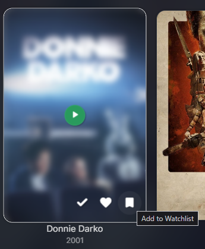 |

&nbsp;

## **Skin Manager**

The Skin Manager adds the functionality for users to change the appearance of the Web UI from a button in the top header, or from their Display Preferences in their User Account.

<table align="center" style="width: 100%;">
  <tr>
    <th style="text-align:center; width: 44.2%;">Top Header Button</th>
    <th style="text-align:center;">User Display Preferences</th>
  </tr>
  <tr>
    <td style="width: 35%;">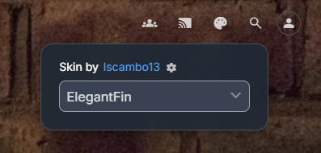</td>
    <td style="width: 65%;">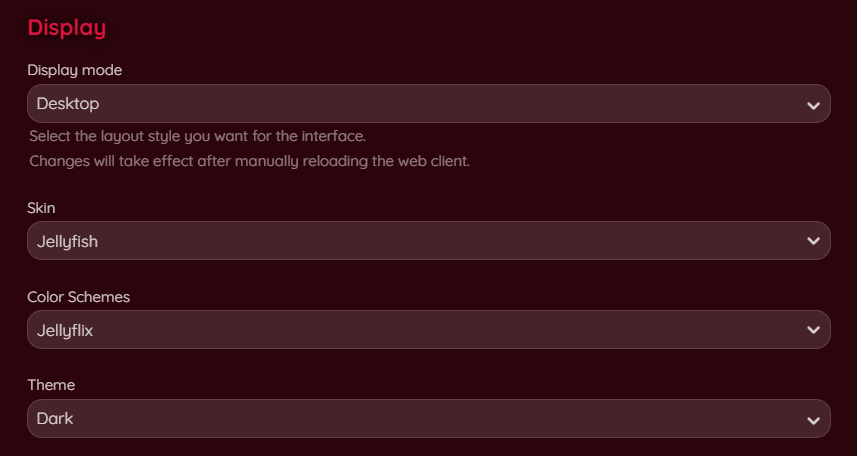</td>
  </tr>
</table>
<br/>

- **Skins**  
  Select from a list of pre-defined Skins created by other Jellyfin community members. You may specify additional custom skins in the configuration options.

- **Color Schemes**  
  Certain Skins either support or require a color scheme. This lets you change the UI colors within an individual Skin. These options are automatically available for the Skins which support them.

- **Optional CSS Modules**  
KefinTweaks also includes optional CSS modules from supported Skins, and even adds some of these as Global options for users to take advantage of with any Skin.  
&nbsp;

# UX Improvements

## **Subtitle Search**:

Search and download subtitles directly from the video OSD

| Search and Download Subtitles While Watching Content |
| :---: |
| 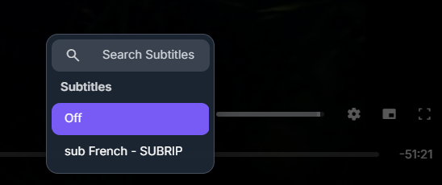 |

&nbsp;

## **Remove from Continue Watching**:

Adds a card overlay button to remove items from Continue Watching for all resumable items

| Remove Progress from any in-progress Items |
| :---: |
| 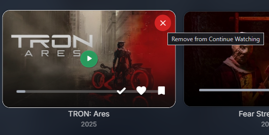 |

&nbsp;

## **Collection Sorting**:

Adds the ability to sort collection items on the Collection page. Supports sorting by Title, Release Date, Date Added, Community Rating, Critic Rating.  
&nbsp;

# Navigation Improvements

## **Header Tab Enhancements**:

Improved tab navigation and functionality, supports linking to specific tabs  
&nbsp;

## **Breadcrumb Navigation**:

Clear navigation paths for Movies, Series, Seasons, Episodes, Music Artists, Albums and Songs

| Navigate using Breadcrumbs at the top of Item pages |
| :---: |
| 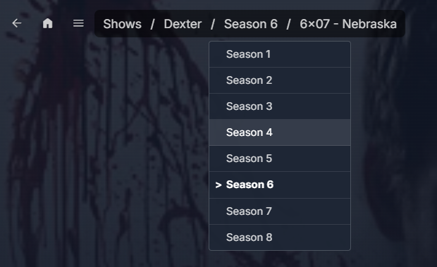 |

&nbsp;

## **Custom Menu Integration**:

Add custom menu links to the side navigation drawer menu

| Navigate to internal or external links from the Top Nav, User Menu, or Side Menu  |
| :---: |
| 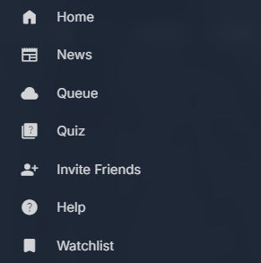 |

&nbsp;

## **Playlist Screen Improvement**:

Updates the default playlist functionality to include a play button to start playback and make clicking an item go to the item detail page  
&nbsp;

## **Episodes on the Series Page**:

Adds an Episodes section on the Series page which displays the episodes from the season with the Next Up item. Users can quickly switch between seasons to browse other episodes. Includes the option to "Flatten Single Season Shows" which will hide the Seasons container when only one season is present.

| Browse Episode listings directly from the Series page  |
| :---: |
|  |

&nbsp;

## **Collections on Movie/Series Details page**:

This shows an "Included In" section on the Item Details page which displays any Collections that the item is a part of.

| See which Collections an Item is Included In  |
| :---: |
| 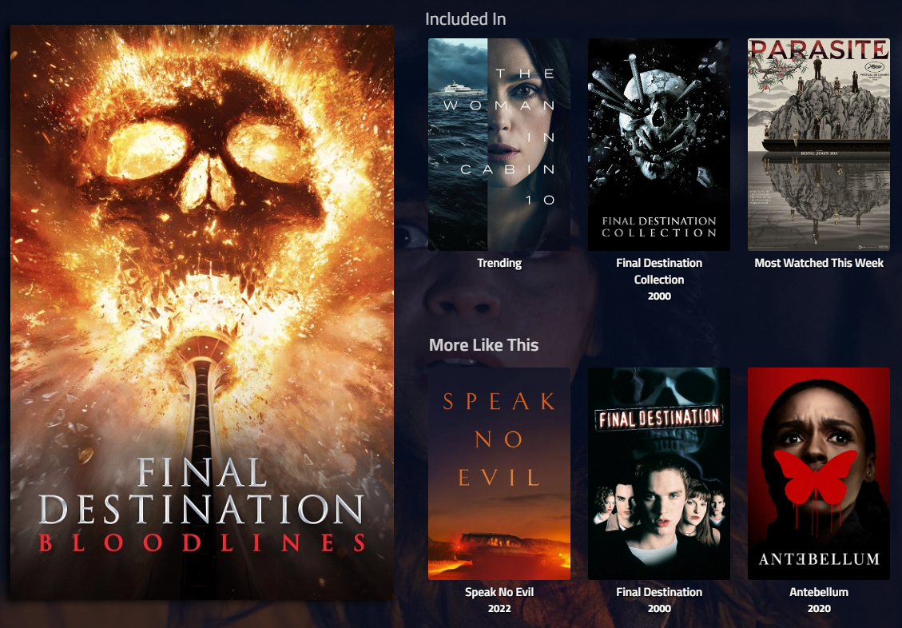 |

&nbsp;

## Desktop Hamburger Menu

Returns the Hamburger Menu to the top left corner on Desktop layouts in the default Modern UI  
&nbsp;

## Custom Pages

This is an internal feature that is leveraged by existing KefinTweaks features like the Watchlist and Games, but can be used for more Custom Pages in the future. This removes the CustomTabs requirement for the Watchlist tab. Existing installations with CustomTabs continue to use that.  
&nbsp;

# System Improvements

## **Performance & Stability**

- **Background Leak Fix**:  
   Resolves an issue that causes backgrounds to be added to the DOM endlesslly when a tab is not focused and Backdrop images are enabled

- **Infinite Scroll**:  
   Adds infinite scrolling to the Movies and TV library pages. Loads batches of 100 items at a time and supports filtering and sorting.

- **LocalStorage Caching**:  
   Local caching for data related to Watchlist, Series Progress, Movie History and Top People

- **Dashboard Button Fix**:  
   Fix to handle navigating back from the dashboard page to the homescreen instead of the "new tab" page of a browser

## **Branding & Customization**

- **Exclusive Elsewhere**:  
  Custom branding for items which aren't available on any external streaming providers. Requires [JellyfinEnhanced](https://github.com/n00bcodr/Jellyfin-Enhanced).

- **Ratings and Comments**:  
Coming soon...requires the [Updoot](https://github.com/BobHasNoSoul/jellyfin-updoot) backend script
&nbsp;

## Info for Developers

This section will detail any information relevant for other developers who wish to take advatange of KefinTweaks features in their own projects:

Currently the only functionality that can be very easily included by developers of other projects is the Watchlist functionality.

The KefinTweaks Watchlist leverages the existing Jellyfin Item UserData field: "Likes". Here is how KefinTweaks handles the funcionality and how you can as well:

- Add a section (on the home screen or elsewhere) which queries the Items endpoint with `Filters=Likes`
- Add a Watchlist toggle button to all card overlays which toggles the UserData Likes value
- Add a listener for PlaybackStopped to check if a Watchlisted item has been watched and automatically remove it from the Watchlist

Even if you only implement the first bullet point and add a section for Watchlist items, KefinTweaks will automatically handle Watchlist syncing whenever the user connects with a KefinTweaks supported client.  
&nbsp;

## Client Support

KefinTweaks is a front end plugin that relies on the Jellyfin Web UI to function. This means that it will function wherever the Jellyfin Web UI is used, and won't function in any apps that don't use the Web UI.

Here is a list of known supported clients:

- Jellyfin Web - Works on any web browser
- [Jellyfin Media Player](https://github.com/jellyfin/jellyfin-media-player)
- [Jellyfin for Android](https://github.com/jellyfin/jellyfin-android)
- [Jellyfin for iOS](https://github.com/jellyfin/jellyfin-ios)
- [Jellyfin for WebOS](https://github.com/jellyfin/jellyfin-webos)
- [Jellyfin for Tizen](https://github.com/jellyfin/jellyfin-tizen)* (maybe)

These third party clients support the same Watchlist as KefinTweaks:

- [AFinity by MakD](https://github.com/MakD/AFinity)
- [Streamyfin](https://github.com/streamyfin/streamyfin)
- [Pelagica](https://github.com/KartoffelChipss/pelagica)  
&nbsp;

## Changes to default Jellyfin functionality

A few things to note about KefinTweaks functionality in general and how it interacts with the default Jellyfin functionality:

### What functionality is additive?

- Watchlist
- Series Progress
- Movie History
- User Statistics
- Enhanced Home Screen
- Appearance/Skin Manager
- Subtitle Search in Video OSD
- Remove from Continue Watching
- Breadcrumb Navigation
- Custom Menu Links
- Collections on Details Page
- SeriesInfo+

### What functionality is modified?

- Infinite Scroll for Library Pages
    - Pagination controls are hidden in favor of infinite scrolling
- Playlist Page UX
    - Clicking playlist items navigates to the item page instead of playing the item
    - A play button is added to each item on the Playlist page to allow the user to play the item directly
    - The Playlist Play button now resumes the Playlist by default instead of playing it from the beginning
    - A new button is added to play the Playlist from the beginning
- Episodes of Series Page
    - Episodes from the Season of the Next Up episode are displayed in a section with the Next Up item being focused
    - The default Jellyfin "Next Up" section is hidden in favor of the above
    - With the Flatten Single Season Shows enabled, the normal Seasons section is hidden for shows with only 1 season
- Background Leak Fix
    - This removes extra backdrops from the DOM
    - It fixes an issue which causes Jellyfin to endless add backdrop items to the DOM if the Jellyfin browser tab is not focused
- Search
    - The default Jellyfin search is hidden in favor of the KefinTweaks search
    - KefinTweaks does not block default Jellyfin search requests, but they will only be triggered when manually navigating to the search page with a searchTerm in the url. In this circumstance, the duplicate search results are hidden.
- Dashboard Button Fix
    - This fix prevents the Back button in the Dashboad from navigating back to the "new tab" page in your browser  
&nbsp;

## Design Philosophy

The general design philosophy here is to utilize as much pre-existing Jellyfin functionality as possible in order to ensure long term compatibility, and also to potentially make it a bit easier for anyone interested in taking these ideas into the core Jellyfin projects. Even where functionality is being "overridden" we still typically utilize underlying Jellyfin functionality to achieve the results desired.

The only real Plugin dependency that KefinTweaks has is JS Injector which is being used to both load the KefinTweaks scripts, and save configuration data on the server. Loading the scripts without JS Injector is very simple, but without another way of storing configuration data on the server, JS Injector is absolutely required if you wish to override any of the default configuration options in the UI.

The main goal of this project is to push the limits of what is possible through a "front end plugin". All of the code in this project is executed by the client. This is quite unusual in terms of the typical Jellyfin plugin, but I hope it may be inspiring for other future creations down the road. I would also be very happy if the changes included here helped push forward the progress to get these changes implemented in the core Jellyfin project so that everyone can take advantage of them without needing a third party plugin.  
&nbsp;

## AI Disclaimer

To preface this, I want to say that historically, all of the community oriented projects I have worked on in the past have been composed nearly entirely by code that I have written myself. As new development tools have been released, I have tried to take advantage of them as much as possible in order to improve my own learning and to make my projects better. I understand that everyone has different personal feelings regarding the use of AI, so I wanted to leave a statement to make it clear about how I have chosen to use AI for this project in particular.

I have started this project with a polar opposite approach from my past endeavors. With the rise of "vibe coding" I wanted to see what I could achieve using a similar philosophy. I understand the obvious short comings of using such a methodology, and I believe that in the majority of the situations it will be very detrimental in the long run. Where I can see this type of tool excelling, is the exact use case of KefinTweaks: mostly small self contained scripts which don't rely on any external pieces of logic. This is one of the main motivating factors that led me to believe I could achieve what I desire purely through "vibe coding".

As it stands right now, and how I expect to proceed going forward, is to act in a role of "Project Manager" instead of "coder/developer". I don't blindly include every bit of code that is provided by my prompts. I make very thorough prompts that essentially provide very detailed documentation of the features to be implemented, in the same way a real project manager might provide this documentation to their team. I am not doing this for practice as I no longer professionally work in the design industry and have no plans to, but moreso just for fun and to see what the results are.

The journey so far has been quite enjoyable. The scale of KefinTweaks has expanded a lot over time, so I do certainly have my concerns about the sustainability of this approach, but I plan to continue on like this unless I hit a roadblock. I hope that this choice will not deter you from trying this plugin, but I did want to make the use of AI clear as I understand that it is a hot issue in the industry and around the globe. My personal view is that AI should be used responsibly as a tool, just like any other tool. I think that AI has no place in replacing artists and other creative work that humans carry out.  
&nbsp;

## License

This project is licensed under the MIT License - see the [LICENSE](LICENSE) file for details.  
&nbsp;

## Acknowledgments

- **Jellyfin Team**: For the fantastic Jellyfin media server
- **[n00bcodr](https://github.com/n00bcodr)**: For JellyfinEnhanced, the JS Injector Plugin and moral support
- **[IAmParadox27](https://github.com/IAmParadox27)**: For the Custom Tabs Plugin
- **[BobHasNoSoul](https://github.com/BobHasNoSoul)**: For the jellyfin-updoot functionality
- **[The Jellyfin Community](https://discord.gg/v7P9CAvCKZhttps://discord.gg/v7P9CAvCKZ)**: For sharing knowledge and providing a welcoming environment to ask questions and learn
- **[movie-monk-b0t](https://github.com/movie-monk-b0t)**: For the IMDb Top 250 JSON data
- **[freefrontend.com](https://freefrontend.com/css-frames/)**: For the custom card border styles and ideas.
- **[Unsplash](https://unsplash.com/) and [Pexels](https://www.pexels.com/): For the images related to the Thematic Picks home sections**  
&nbsp;

## FAQ

> ### I saved the KefinTweaks Plugin script in JS Injector but I don't see KefinTweaks in the Dashboard menu

You must complete the installation by clicking the KefinTweaks plugin and selecting the installation source (either GitHub or local) from the KefinTweaks plugin card at the very bottom of your Plugins page:

| Check for pending installation  |
| :---: |
| 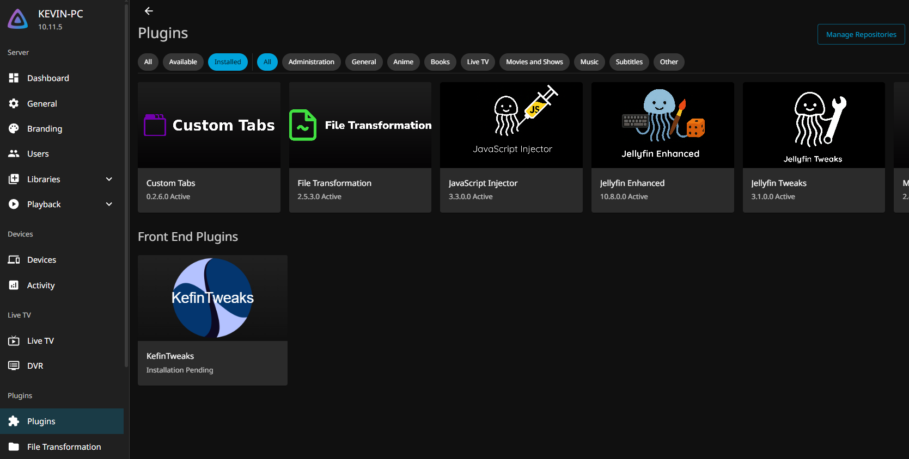 |

> ### KefinTweaks Plugin never appears in the Plugins page even though I saved the KefinTweaks Plugin script in JS Injector

Ensure `JavaScriptInjector\public.js` is loaded by the client:

- Open DevTools (right-click page > inspect)
- Click Sources tab
- Verify that `JavaScriptInjector\public.js` is present:

| Check for public.js injection  |
| :---: |
| 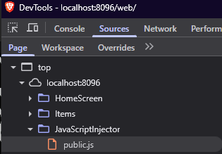 |

If you don't see the public.js from JS Injector, please ensure that you have [File Transformation plugin](https://github.com/IAmParadox27/jellyfin-plugin-file-transformation) installed.

If you do see the public.js from JS Injector, this may be an issue related to the browser cache. Follow the instructions below to ensure your browser cache is up to date.

> ### My Watchlist Tab is empty

If you see the tab button for Watchlist, but clicking it brings you to an empty page, this is almost certainly due to a caching issue. Please follow the instructions below to ensure your browser cache is up to date.

> ### How do I clear my client cache?

You may sometimes end up in a situation where the jellyfin-web client is not correctly reflecting your KefinTweaks configuration. To ensure KefinTweaks is delivering its scripts based on your current configuration, you may need to perform a "hard refresh" which will bypass the cache:

- Use "Ctrl+F5" or "Ctrl+Shift+F5" to refresh the page, or:
- Open Devtools (right-click page > inspect)
- Click the Network tab
- Check the "Disable Cache" checkbox
- Refresh your page while keeping the Devtools window open

| Disable Browser Cache  |
| :---: |
| 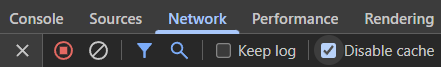 |

## Support

- **Issues**:  
  KefinTweaks is not maintained by the Jellyfin team, and as a result you are encouraged to seek support from me directly. Sadly, there is no place suitable for discussion of plugins built by community members or fan-made projects in the official Jellyfin Discord, so please visit the [Jellyfin Community Discord](https://discord.gg/v7P9CAvCKZhttps://discord.gg/v7P9CAvCKZ) to find me (username: HighImKevin) and other users who would be happy to help you out. Please also feel free to report bugs and request features from the Issues page.

- **Documentation**:  
This README and the inline comments in kefinTweaks.js and the other scripts is the only real documentation available at this time  
&nbsp;

## Version History

- **v0.4.0**: New Features: Proper Install Flow, Watchlist->Playlist Sync, Series Info+, Series Page Episodes, Christmas Seasonal Home Screen
- **v0.3.5**: Critical bug fix
- **v0.3.4**: Improved handling of Latest/Development branches for KefinTweaks installation. Improved collection caching.
- **v0.3.3**: Important fix for a bug preventing the plugin from running on non-admin accounts
- **v0.3.2**: Add proper installation and uninstallation support from the Plugins page. New feature: Playlist sorting.
- **v0.3.1**: New Home Screen Section feature: Spotlights! Improved Configuration UI.
- **v0.3.0**: KefinTweaks configuration for admins in the Jellyfin UI!
- **v0.2.4**: New Feature: Watchlist Export/Import
- **v0.2.3**: New Feature: Collection Sorting, general fixes
- **v0.2.2**: Add support for skin server versions, fixes for HeaderTabs
- **v0.2.1**: Caching improvements for Watchlist and Top People, Mobile UI fixes and Flatten TV Shows improvements
- **v0.2.0**: New Features: Skin Manager, Collections on Details Page, Flatten TV Shows
- **v0.1.3**: Improve Watchlist UI and Search UX
- **v0.1.2**: Added proper support for Base URLs configured in Jellyfin
- **v0.1.1**: Fixes for Watchlist UI elements and performance improvements for Watchlist and Search
- **v0.1.0**: Initial release for Jellyfin 10.10.7
